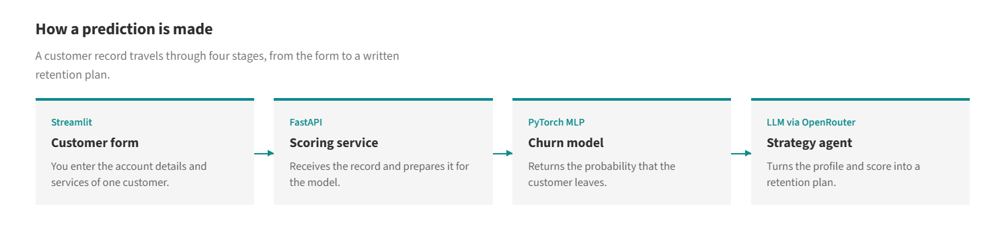
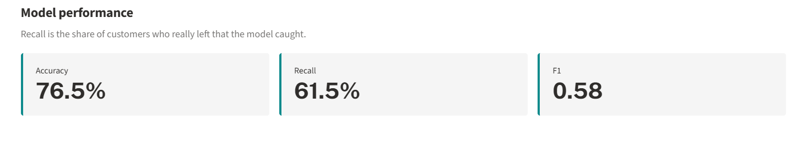

# AI Churn Predictor 


End - to - End ML service for churn prediction, based on TelCo data and powered by LLM assistant.
**LINK**: *https://ai-churn-predictor-pypy.streamlit.app/*

## About Project
This project is aimed to predict client departure in the field of digital services and prevent it using AI assistant's strategy. In a nutshell,
AI Churn Predictor assists companies in these sphere not to lose their consumers, and accordingly, not to lose profit of the company.

**Bullet Points**:
- ML(DL) model (PyTorch MultiLayerPerceptrone) for evaluating departures
- FastAPI with validation
- Interactive interface (realised on Streamlit)

## Architecture

**Behind the scenes**
- As you can see in the picture, I used *OpenRouter API LLM key*  and *openai client* to create an AI Assistant.
- As about LLM, I chose **nvidia/nemotron-3.5-super-vl:free** model due to the fact that *it works stably* and *performs well in tasks of this kind (among free models, of course).*

## Technical Stack
- Python 3.11
- PyTorch
- FastAPI
- Streamlit 
- Docker
- Pandas 
- Deploy via Render
- Json
- Uvicorn
- Git (ofc)


## Quick Start
1. **via Docker** (must be installed):
```bash 
# Clone repo
git clone https://github.com/Ivampypy/churn-predictor.git
cd churn-predictor
# Build and run the containers
docker-compose up --build -d
```
After the app will be available on:
- **Frontend(UI)**: *http://localhost:8501*
- **API Docs**: *http://localhost:8000/docs*

2. **Locally**(without Docker)(*recommended*).

*First step*. Create virtual env & install requirements:
```bash 
python -m venv venv
source venv/bin/activate  # For Windows: .\venv\Scripts\activate
pip install -r requirements.txt
```
*Second step*. Run FastAPI:
```bash 
uvicorn api.main:app --reload
```
*Third step*. In new terminal run Streamlit (Frontend):
```bash 
streamlit run frontend/Main_Page.py
```

## Metrics & Evaluation
After training, I have reach some results.
They are presented on the main page of site.


## Limitations
- Very slow Quick start via Docker
- "Sleeping website": Render Free Tier is down after 15 minutes of inaction

## Contacts
Any suggestions/questions? You can keep in touch with me via:
- Telegram: **@nepipipip**
- LinkedIn: **www.linkedin.com/in/ivan-karzin-64940244a**
